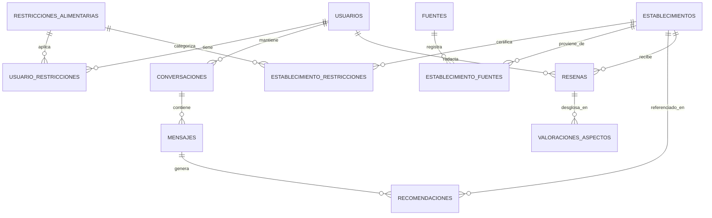
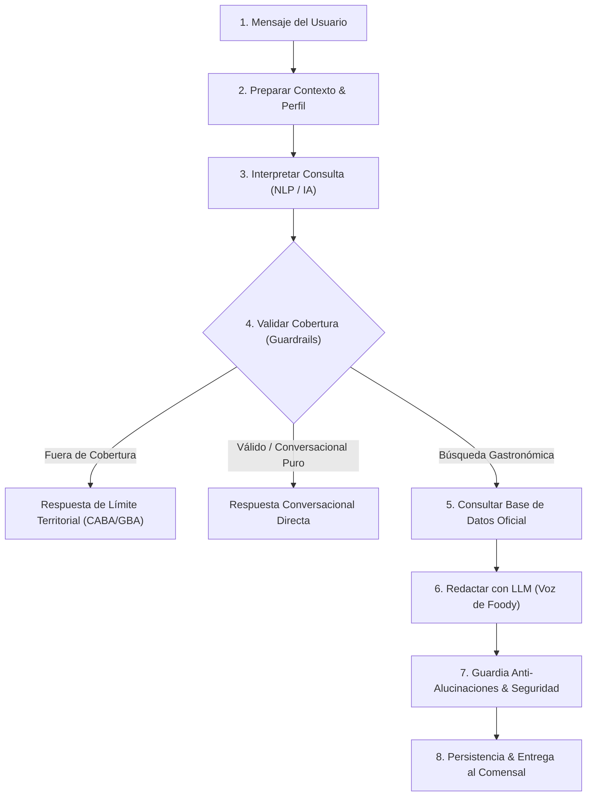

# GastronomIA — Foody: Stack Tecnológico y Funcionalidades

Documento técnico y funcional descriptivo de la plataforma **GastronomIA** y su asistente gastronómico inteligente **Foody**.

---

## 1. Visión General del Proyecto

**GastronomIA** es una plataforma web progresiva (PWA / Web App) orientada al descubrimiento gastronómico en la **Ciudad Autónoma de Buenos Aires (CABA)** y el **Gran Buenos Aires (GBA - Zona Norte, Sur y Oeste)**. 

Combina un catálogo masivo validado con datos públicos oficiales (GCBA, OpenStreetMap, ANMAT), mapeo interactivo con clustering geográfico y un asistente conversacional con inteligencia artificial generativa (**Foody**) capaz de recomendar lugares, armar itinerarios y respetar estrictamente restricciones alimentarias (celiaquía/sin TACC, veganismo, vegetarianismo, alergias).

---

## 2. Stack Tecnológico

```
GastronomIA - Foody
│
├── Frontend (Client-Side)
│   ├── Next.js 14.2 (React 18, App Router)
│   ├── Tailwind CSS 3.4 (Diseño responsivo, Paleta corporativa, Modo oscuro)
│   ├── Lucide React (Sistema de iconos vectoriales)
│   ├── Leaflet 1.9 + Leaflet.markercluster (Mapas y clustering geográfico)
│   ├── HTML5 Canvas + QRCode Engine (Generación y personalización de QR dinámicos)
│   └── Web Storage API (localStorage para persistencia de perfil y preferencias)
│
├── Backend (Serverless & APIs)
│   ├── Next.js Route Handlers (Arquitectura Serverless en Vercel)
│   ├── Backend Orquestador en 8 Etapas (Pipeline conversacional y guardrails)
│   ├── SQLite Nativo (`node:sqlite`) con fallback a Store en Memoria
│   └── Base de datos relacional de 12 entidades normalizadas
│
├── Inteligencia Artificial & NLP
│   ├── Google Gemini API (gemini-3-flash-preview, gemini-3.5-flash, gemini-3.5-flash-lite)
│   ├── Failover Multi-Proveedor (Soporte para Groq y OpenAI)
│   ├── Motor Conversacional Híbrido (Extracción NLP + Fallback determinístico autónomo)
│   └── Guardrails bromatológicos y de delimitación geográfica
│
└── Infraestructura & DevOps
    ├── Git & GitHub (Control de versiones)
    └── Vercel (CI/CD automático y hosting en el Edge)
```

### 2.1. Frontend & UI/UX

| Tecnología | Versión | Propósito / Uso en la Aplicación |
| :--- | :--- | :--- |
| **Next.js** | 14.2.x | Framework principal con arquitectura App Router (`app/`). Renderizado híbrido (SSR + Client Components). |
| **React** | 18.x | Biblioteca de interfaces de usuario. Manejo de estados complejos (`useState`, `useEffect`, `useRef`, `useMemo`). |
| **Tailwind CSS** | 3.4.x | Framework de utilidades CSS. Configuración con colores de marca (`#133829` verde bosque, `#D4AF37` dorado, `#FCE7A2` crema), tipografía *Plus Jakarta Sans*, modo oscuro y soporte móvil integral. |
| **Lucide React** | 1.63.x | Iconografía SVG ligera, coherente y accesible en toda la interfaz. |
| **Leaflet** | 1.9.4 | Motor de mapas interactivos de código abierto sin dependencia de claves pagas de Google Maps. |
| **Leaflet.markercluster** | 1.5.3 | Algoritmo de agrupamiento visual de marcadores en círculos dinámicos por densidad geográfica con apertura progresiva al hacer zoom. |
| **QRCode** | 1.5.x | Generación de matrices QR con corrección de errores Nivel H (30%) y renderizado en HTML5 Canvas con estilos personalizados. |
| **Web Storage (localStorage)** | Nativo | Persistencia permanente en el cliente del perfil (`foody_user_profile`), estado del sidebar, favoritos y claves API opcionales. |

### 2.2. Backend & Capa de Persistencia

| Tecnología | Componente | Descripción |
| :--- | :--- | :--- |
| **Next.js Route Handlers** | API RESTful | Endpoints modulares en `/api/chat`, `/api/establecimientos`, `/api/usuarios`, `/api/restricciones`, `/api/resenas` y `/r`. |
| **node:sqlite** | Base de Datos Relacional | Motor nativo SQLite integrado en Node.js, rápido y sin dependencias pesadas de drivers nativos compilados. |
| **Store en Memoria (Fallback)** | Alta Disponibilidad | Estructura en memoria que entra en acción automáticamente si el entorno de ejecución no soporta SQLite nativo. |
| **Redirección HTTP 307** | Endpoint `/r` | Mecanismo de redirección temporal sin almacenamiento en caché para códigos QR dinámicos reasignables. |

### 2.3. Inteligencia Artificial & Orquestación NLP

| Componente | Proveedor / Modelo | Función |
| :--- | :--- | :--- |
| **LLM Primario** | Google Gemini `gemini-3-flash-preview` | Inferencia ultrarrápida (<1.5s), comprensión de lenguaje natural y redacción fluida. |
| **LLM Secundario / Failover** | Google Gemini `gemini-3.5-flash` / `gemini-3.5-flash-lite` | Respaldo automático con conmutación transparente en caso de saturación o error 503/429. |
| **LLM Opcionales** | Groq (`llama-3.3-70b-versatile`), OpenAI (`gpt-4o-mini`) | Compatibilidad multi-proveedor configurable por el usuario mediante clave personalizada. |
| **Motor NLP Local** | Algoritmos de Reglas Semánticas | Extracción determinística de zona, tipo de cocina, presupuesto, ambiente y restricciones alimentarias. |
| **Fallback Humano Autónomo** | Motor Local de Respuestas | Generación de respuestas naturales y recomendación directa cuando no hay conexión de API o se opera en modo gratuito/offline. |

---

## 3. Arquitectura del Modelo de Datos (12 Entidades)

El sistema implementa una arquitectura relacional normalizada:



1. **`usuarios`**: Perfil del comensal, nombre, presupuesto preferido, ambiente y cocina favorita.
2. **`restricciones_alimentarias`**: Catálogo base (Sin TACC, Vegano, Vegetariano, Sin Lactosa) + soporte dinámico para restricciones personalizadas ("Otro": alergias a mariscos, frutos secos, APLV, Kosher).
3. **`usuario_restricciones`**: Relación n:m entre usuarios y sus restricciones activas.
4. **`establecimientos`**: Locales gastronómicos con datos de geolocalización (latitud, longitud), barrio, zona (CABA, Norte, Sur, Oeste), tipo de cocina, rango de precio (`$`, `$$`, `$$$`), ambiente y descripción de recomendación.
5. **`establecimiento_restricciones`**: Validación de aptitud dietaria con atributo de nivel de información (ej. "100% libre de gluten certificado").
6. **`fuentes`**: Registros oficiales de origen (Portal de Datos Abiertos GCBA, OpenStreetMap, ANMAT, Municipios GBA).
7. **`establecimiento_fuentes`**: Trazabilidad con fecha de relevamiento e identificador externo.
8. **`conversaciones`**: Sesiones de diálogo sostenidas entre comensal y Foody.
9. **`mensajes`**: Mensajes individuales intercambiados (usuario o bot) con parámetros interpretados almacenados en JSON.
10. **`recomendaciones`**: Registro histórico de qué locales fueron recomendados en cada mensaje y el orden de relevancia.
11. **`resenas`**: Opiniones y puntuaciones otorgadas por los comensales.
12. **`valoraciones_aspectos`**: Desglose granular de opiniones procesadas con NLP (atención, comida, ambiente, protocolo celíaco, sentimiento).

---

## 4. Flujo de Orquestación del Chat (Pipeline en 8 Etapas)

Cada mensaje enviado en el chat atraviesa un flujo orquestado diseñado para garantizar respuestas rápidas, seguras y libres de alucinaciones:



1. **Recepción y Registro:** Se almacena el mensaje del usuario y se asocia a la sesión activa.
2. **Preparación de Contexto:** Se recupera el perfil del usuario (desde `localStorage` / cliente con fallback en DB) y los últimos turnos de diálogo para mantener el hilo de la charla.
3. **Interpretación Semántica:** El motor NLP extrae criterios en formato JSON estricto (`zona`, `tipo_cocina`, `rango_precio`, `ambiente`, `restricciones`).
4. **Guardrails de Cobertura:** Si el comensal consulta por ciudades no cubiertas (ej. Córdoba, Madrid), el flujo corta de inmediato explicando amablemente el límite territorial oficial.
5. **Consulta SQL Estricta:** Se buscan los locales que cumplen los criterios exclusivamente en la base de datos oficial.
6. **Generación con la Voz de Foody:** El LLM redacta la recomendación aplicando las reglas de tono (español latino de Argentina educado, voseo natural, sin modismos exagerados, sin saludos repetitivos en mensajes de seguimiento y con saltos de línea legibles).
7. **Guardia Anti-Alucinaciones:** Se verifica que ningún restaurante inventado por el LLM se filtre en la respuesta final y se incorporan las advertencias bromatológicas pertinentes.
8. **Persistencia y Entrega:** Se guardan las recomendaciones en la base y se retorna la respuesta con las fichas interactivas listas para renderizar.

---

## 5. Módulos y Funcionalidades de la Aplicación

### 5.1. Asistente Conversacional "Foody"
- **Memoria Conversacional Real:** Recuerda los locales mencionados anteriormente para responder repreguntas naturales (ej. *"¿Son económicos esos lugares?"*, *"¿Cómo llego?"*, *"¿Tienen patio?"*).
- **Control Estricto de Saludos:** Saluda cálidamente por su nombre en el primer contacto y **nunca repite saludos redundantes** en turnos intermedios.
- **Formato Limpio:** Recomendaciones claras y separadas por párrafos, sin textos técnicos ni citas entre paréntesis en medio de las oraciones.
- **Avisos de Seguridad Bromatológica:** Alertas visibles ante opciones sin TACC o dietas especiales recordando consultar por contaminación cruzada.

### 5.2. Modal de Onboarding (Primer Ingreso)
- Despliegue automático en la primera visita cuando no existe perfil previo en el navegador.
- Solicita el nombre del comensal (*"¿Cómo te gustaría que te llame Foody?"*).
- Selector de restricciones con **"Sin Restricciones"** activa por defecto y opciones destildadas (*Celíaco / Sin TACC*, *Vegano*, *Vegetariano*, *Sin Lactosa*).
- Soporte para **restricción personalizada ("Otro")** mediante un campo de texto dinámico.
- Preferencia de zona inicial (*CABA, Zona Norte, Zona Sur, Zona Oeste*).
- Persistencia inmediata en `localStorage` con botón de *"Comenzar a descubrir"* y opción de *"Omitir por ahora"*.

### 5.3. Mapeo Interactivo con Clustering
- Mapa de pantalla completa desarrollado con **Leaflet** y tiles optimizados de OpenStreetMap / CartoDB.
- Agrupamiento dinámico por densidad con círculos numéricos coloreados según la concentración de locales (verde, amarillo, naranja).
- Apertura automática de clusters (*zoom in*) hasta llegar a los marcadores individuales.
- Popups interactivos con nombre, barrio, tipo de cocina, precio, botón de favoritos y acceso a la ficha completa.

### 5.4. Explorador con Filtros Facetados
- Catálogo navegable con tarjetas responsivas.
- Búsqueda en tiempo real por texto libre.
- Filtros simultáneos por:
  - **Zona Geográfica:** CABA (Palermo, Recoleta, Belgrano, San Telmo, etc.), Zona Norte (San Isidro, Vicente López), Zona Sur (Avellaneda, Lanús, Banfield), Zona Oeste (Ramos Mejía, Morón, San Martín).
  - **Tipo de Cocina:** Parrillas, Pizzerías, Pastas, Bodegones, Cafeterías de especialidad, Vegana, Armenia/Medio Oriente.
  - **Rango de Precio:** Accesible (`$`), Moderado (`$$`), Gourmet/Alta gama (`$$$`).
  - **Ambiente:** Tranquilo, Familiar, Romántico, Aire libre / Jardín, Moderno.
  - **Aptitud Alimentaria:** Sin TACC, Vegano, Vegetariano, Sin Lactosa.

### 5.5. Fichas de Detalle & Reseñas
- Modal detallado con fotografía, dirección, categoría y por qué lo recomienda Foody.
- Enlace directo a llamada telefónica y sitio web.
- Visualización de fuentes oficiales de procedencia de los datos.
- Desglose de reseñas y valoraciones por aspecto con indicador visual de sentimiento.
- Formulario interactivo para que el usuario agregue nuevas reseñas con calificación de 1 a 5 estrellas.

### 5.6. Perfil Persistente y Avatar Dinámico
- Vista dedicada de **Perfil** para modificar en cualquier momento gustos, presupuesto, ambiente y restricciones.
- Sincronización transparente con `localStorage` y la base de datos.
- **Avatar con iniciales dinámicas:** El botón superior de usuario calcula automáticamente las iniciales del nombre configurado (ej. **"M"** para Maximiliano) en lugar de iniciales genéricas.
- Saludo personalizado en el Hero de la pantalla de inicio: *"¡Hola Maximiliano! Soy Foody, tu asistente de GastronomIA"*.

### 5.7. Favoritos & Mis Lugares
- Guardado local de locales favoritos con persistencia instantánea.
- Contador dinámico en el sidebar y en la barra de navegación móvil.
- Sección de itinerarios y rutas gastronómicas temáticas sugeridas.

### 5.8. Sistema de Código QR Dinámico Personalizado
- **Ruta de Redirección Inteligente (`/r`):** Endpoint serverless que aplica redirección temporal HTTP 307 al destino configurado en variables de entorno o valor por defecto (`https://gastronomia-foody.vercel.app`).
- **Inmunidad a Reimpresiones:** Permite reasignar el destino del QR en Vercel en cualquier momento sin necesidad de cambiar el QR impreso.
- **Página de Gestión y Descarga (`/qr`):**
  - **Pestaña Código QR Solitario:** Código QR cuadrado personalizado con fondo amarillo cálido, matriz de puntos redondeados, ojos temáticos con centro dorado y la **mascota de Foody en un medallón central**. Botón de descarga en PNG de alta resolución (800x800).
  - **Pestaña Cartel / Flyer Completo:** Diseño publicitario completo listo para imprimir en mesas o cartelería (con pill de *Foody*, *Tu asistente de GastronomIA*, destellos dorados y banner inferior *¡ESCANÉAME Y DESCUBRE NUEVOS SABORES!*).

---

## 6. Diseño Responsivo & Ergonomía Móvil

- **Escritorio:** Sidebar lateral colapsable con persistencia en `localStorage`, panel contextual derecho con accesos directos por zona y banners de experiencias.
- **Celular / Móvil:** 
  - Drawer lateral colapsable off-canvas con botón de apertura en el header.
  - Barra de navegación inferior ergonómica fija (*Bottom Nav*) con accesos rápidos: **Inicio, Explorar, Foody (botón central destacado), Mis lugares, Favoritos (con badge de contador) y Perfil**.
  - Zonas táctiles optimizadas para uso con una sola mano.
  - Soporte completo para modo oscuro (*Dark Mode*) conmutador en un clic.

---

## 7. Despliegue e Infraestructura en Producción

- **Plataforma:** Vercel (Edge Network + Serverless Functions).
- **Estrategia de Branching:** Repositorio principal en GitHub (`main`), con *deploys* automáticos disparados ante cada `git push`.
- **Compatibilidad Serverless:** La aplicación maneja la arquitectura efímera de contenedores serverless respaldando los datos del usuario en el cliente (`localStorage`) y enviándolos en el cuerpo de cada solicitud al orquestador.

