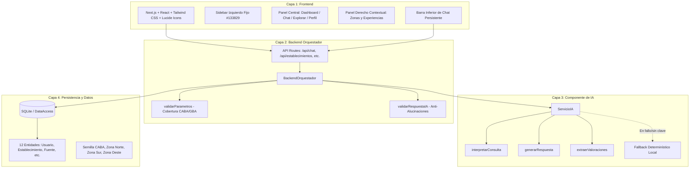
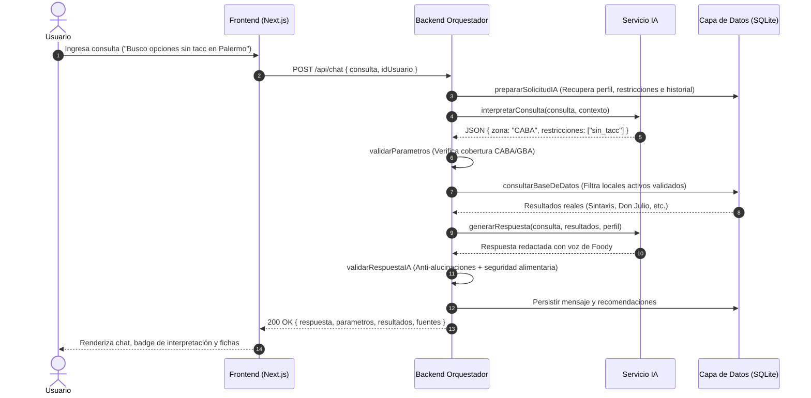

# 🍽️ GastronomIA — Asistente Gastronómico Inteligente con "Foody"
> Plataforma y asistente conversacional para la Ciudad Autónoma de Buenos Aires (CABA) y el Gran Buenos Aires (GBA), fundamentado estrictamente en datos validados y directivas de seguridad alimentaria.


---

## 📌 1. Visión y Propósito
**GastronomIA** es un sistema inteligente que combina la calidez y el conocimiento porteño de su mascota **"Foody"** con una arquitectura de software robusta, desacoplada y de alta cohesión en 4 capas.

El principio cardinal del sistema es:
> **La IA interpreta el lenguaje natural y redacta respuestas en tono empático y cordial, pero NUNCA inventa datos.**  
> Toda recomendación proviene de establecimientos reales, activos y validados en la base de datos oficial, citando explícitamente sus fuentes públicas y advirtiendo sobre protocolos bromatológicos.

---

## 🏛️ 2. Arquitectura de Software en 4 Capas



### Capa 1: Frontend (Next.js 14 + React + Tailwind CSS + Lucide Icons)
- **Layout Dashboard en 3 Columnas:**
  1. **Sidebar Izquierdo Fijo (`#133829`):** Header con avatar de Foody y título *"Foody - Tu asistente de GastronomIA"*, navegación vertical (`Inicio`, `Chat`, `Explorar`, `Mis lugares`, `Favoritos`, `Perfil`) y pie cultural con iconografía dorada y leyenda *"Buenos Aires y Gran Buenos Aires"*.
  2. **Panel Central Principal (`#F8F7F2`):** Top bar con barra de búsqueda `"¿Qué estás buscando hoy?"`, controles de accesibilidad/modo oscuro, hero card de bienvenida de Foody con ilustración del robot chef, Bento Grid de 2 filas y barra inferior de chat persistente.
  3. **Panel Derecho Contextual:** Banner del Obelisco al atardecer, selector interactivo de 4 zonas (`CABA`, `Zona Norte`, `Zona Sur`, `Zona Oeste`), widget *"Tus experiencias"* y banner inferior de Foody.
- **Vistas Especializadas:**
  - `Chat`: Interfaz conversacional con tag visual `"Interpreté: [Zona, Ambiente, Presupuesto, Dieta]"`, recomendaciones estructuradas y citas de fuente.
  - `Explorar`: Filtros manuales combinados (zona, tipo de cocina, presupuesto $, $$, $$$, restricción alimentaria y búsqueda en tiempo real).
  - `Modal / Ficha`: Dirección, teléfono, web, motivo de recomendación, fuente, reseñas con valoraciones extraídas por IA y **banner amarillo obligatorio de advertencia alimentaria**.
  - `Perfil`: Configuración y persistencia de restricciones (`Vegano`, `Celíaco / Sin TACC`, `Sin lactosa`, `Vegetariano`), presupuesto y preferencias.

### Capa 2: Backend Orquestador (`lib/backendOrquestador.js`)
Controla el flujo de negocio y aplica las políticas de seguridad:
- `procesarConsulta(consulta, idUsuario, idConversacion)`: Orquesta las 8 etapas del ciclo de vida.
- `prepararSolicitudIA(consulta, idUsuario, idConversacion)`: Rescata preferencias, restricciones e historial de turnos previos para sostener contexto conversacional.
- `validarParametros(parametros)`: Verifica límites geográficos (CABA/GBA). Si el usuario pide Córdoba, Mendoza, Madrid, etc., aborta la consulta a la base de datos y emite respuesta de límite territorial.
- `consultarBaseDeDatos(parametros)`: Ejecuta queries estrictas sobre establecimientos activos.
- `validarRespuestaIA(respuesta, resultados)`: Filtro anti-alucinaciones: verifica que los locales nombrados pertenezcan a los resultados validados y que no se realicen afirmaciones peligrosas de seguridad absoluta.

### Capa 3: Componente de IA (`lib/servicioIA.js`)
Conecta con modelos de lenguaje vía `process.env.AI_API_KEY` (Gemini, Claude u OpenAI) con mecanismo de fallback determinístico:
- `interpretarConsulta(consulta, contexto)`: Extrae `{ zona, tipo_cocina, rango_precio, ambiente, restricciones, intencion_valida, fuera_de_cobertura }`.
- `generarRespuesta(consulta, resultados, perfilUsuario)`: Redacta la respuesta empática con la voz y personalidad de Foody, explicando los motivos, citando fuentes e incluyendo advertencias.
- `extraerValoraciones(textoResena)`: Al registrar una reseña en `/api/resenas`, extrae automáticamente un array JSON de `{ aspecto, sentimiento, detalle }`.

### Capa 4: Persistencia y Capa de Datos (`lib/db.js`)
Implementa las **12 entidades canónicas del diseño**:
1. `Usuario`
2. `RestriccionAlimentaria`
3. `UsuarioRestriccion`
4. `Preferencia`
5. `HistorialPreferencia`
6. `Establecimiento`
7. `EstablecimientoRestriccion` (con atributo obligatorio `nivel_informacion`)
8. `Fuente`
9. `EstablecimientoFuente`
10. `Conversacion`
11. `Mensaje`
12. `Recomendacion`
13. `Resena` y `Valoracion`

Incluye una semilla realista de **18 establecimientos distribuidos estratégicamente**:
- **CABA:** Don Julio (Palermo), Pizzería Güerrin (San Nicolás), Sarkis (Villa Crespo), Sintaxis Sin TACC (Palermo), Buenos Aires Verde (Palermo), Cuervo Café (Colegiales), Bodegón El Obrero (La Boca), Cabaña Las Lilas (Puerto Madero).
- **Zona Norte (GBA):** Alo's Bistro (San Isidro / Boulogne), La Madriguera Café (Vicente López), Parrilla La Choza (San Isidro), Pizzería Tano (San Martín).
- **Zona Sur (GBA):** Pertutti (Avellaneda), Bodegón El Ferroviario Sur (Lanús), Lo de Carlitos (Banfield).
- **Zona Oeste (GBA):** La Cabaña de Ramos (Ramos Mejía), Café Tokio (Morón), Il Vero Pastasciutta (Ciudadela).

---

## 🔄 3. Flujo Orquestado en 8 Etapas



---

## 📋 4. Matriz de Trazabilidad con Historias de Usuario (HU-01 a HU-16)

| ID | Historia de Usuario | Criterio de Aceptación | Capa Principal | Componentes y Archivos |
| :--- | :--- | :--- | :--- | :--- |
| **HU-01** | Búsqueda conversacional en lenguaje natural | El usuario ingresa un texto libre y el sistema interpreta intención sin requerir sintaxis rígida. | Frontend / IA | `PersistentChatBar.jsx`, `ServicioIA.interpretarConsulta` |
| **HU-02** | Extracción estructurada de entidades | Identifica zona, tipo de cocina, presupuesto y restricciones en formato JSON estricto. | IA / Orquestador | `ServicioIA.interpretarConsulta`, `app/api/chat/route.js` |
| **HU-03** | Delimitación y guardrail de cobertura | Si el usuario busca fuera de CABA/GBA (ej. Córdoba, Madrid), se corta el flujo con aviso educado. | Orquestador | `BackendOrquestador.validarParametros` |
| **HU-04** | Consulta fundamentada a base de datos | Solo se recomiendan locales registrados y activos en la base de datos oficial. | Persistencia | `DataAccess.getEstablecimientos`, `BackendOrquestador.consultarBaseDeDatos` |
| **HU-05** | Guardia anti-alucinaciones | Verifica que ningún nombre de restaurante ajeno a los resultados validados aparezca en la respuesta. | Orquestador | `BackendOrquestador.validarRespuestaIA` |
| **HU-06** | Protocolo de seguridad alimentaria | Si hay alergias o celiaquía, no se promete ausencia absoluta y se añade advertencia de contaminación cruzada. | Orquestador / IA | `validarRespuestaIA`, `FOOD_SAFETY_DISCLAIMER`, `VenueModal.jsx` |
| **HU-07** | Transparencia de fuentes públicas | Cada recomendación cita explícitamente su fuente (Portal GCBA, OSM, ANMAT). | Datos / UI | `EstablecimientoFuente`, `ChatView.jsx`, `VenueModal.jsx` |
| **HU-08** | Interfaz Dashboard de 3 columnas | Sidebar verde oscuro `#133829`, panel central crema `#F8F7F2` y panel derecho contextual. | Frontend | `app/page.jsx`, `Sidebar.jsx`, `RightPanel.jsx` |
| **HU-09** | Bento Grid de accesos rápidos | 3 tarjetas en Fila 1 y 2 en Fila 2 que disparan consultas y filtros temáticos. | Frontend | `InicioView.jsx` |
| **HU-10** | Filtros manuales en Explorar | Catálogo con selectores de zona, cocina, presupuesto, restricciones y buscador en vivo. | Frontend / API | `ExplorarView.jsx`, `app/api/establecimientos/route.js` |
| **HU-11** | Ficha completa del establecimiento | Modal con datos de contacto directo (teléfono, web), fotos, motivos y advertencia. | Frontend / API | `VenueModal.jsx`, `app/api/establecimientos/[id]/route.js` |
| **HU-12** | Gestión de perfil y restricciones | Formulario para guardar celiaquía, veganismo, etc., persistiendo en base de datos. | Frontend / API | `PerfilView.jsx`, `app/api/usuarios/[id]/route.js` |
| **HU-13** | Memoria conversacional en repreguntas | Respeta el contexto previo ante preguntas de seguimiento (ej. "¿Cuál es más barato?"). | Orquestador / Datos | `BackendOrquestador.prepararSolicitudIA`, `Conversacion` |
| **HU-14** | Reseñas con extracción de aspectos por IA | Al enviar una reseña, la IA clasifica aspectos, sentimientos y detalles automáticamente. | IA / API | `ServicioIA.extraerValoraciones`, `app/api/resenas/route.js` |
| **HU-15** | Guardado de favoritos y rutas | El comensal puede marcar locales favoritos y visualizar rutas gastronómicas guardadas. | Frontend | `FavoritosView.jsx`, `LugaresView.jsx` |
| **HU-16** | Tolerancia a fallos y fallback local | Si la API de IA falla o no tiene clave, el sistema conmuta a heurística determinística sin romperse. | IA / Orquestador | `ServicioIA._fallbackInterpretarConsulta`, `_fallbackGenerarRespuesta` |

---

## 🌐 5. Endpoints de la API REST

| Método | Endpoint | Descripción |
| :--- | :--- | :--- |
| `POST` | `/api/chat` | Orquesta el flujo de 8 etapas con Foody, devolviendo respuesta, parámetros interpretados y locales. |
| `GET` | `/api/establecimientos` | Consulta catálogo con filtros (`zona`, `cocina`, `presupuesto`, `dieta`, `q`). |
| `GET` | `/api/establecimientos/[id]` | Devuelve la ficha completa con fuentes, restricciones (`nivel_informacion`) y reseñas. |
| `GET` | `/api/restricciones` | Catálogo de restricciones alimentarias registradas. |
| `GET` | `/api/usuarios/[id]` | Obtiene perfil y restricciones activas del usuario. |
| `PUT` | `/api/usuarios/[id]` | Actualiza nombre, presupuesto preferido, ambiente, cocina favorita y restricciones alimentarias. |
| `GET` | `/api/conversaciones/[id]/mensajes` | Historial de mensajes y recomendaciones de una conversación. |
| `POST` | `/api/resenas` | Guarda una nueva reseña y ejecuta la extracción de valoraciones por IA. |

---

## 🛠️ 6. Instalación y Puesta en Marcha

### Requisitos
- **Node.js**: v18.0.0 o superior (recomendado v20+ / v22+)
- **NPM**: v9.0.0 o superior

### 1. Clonar e instalar dependencias
```bash
git clone https://github.com/Maxi-Mut/GastronomIA-Google.git
cd "GastronomIA - Foody"
npm install
```

### 2. Configurar variables de entorno
Copiá el archivo de plantilla `.env.example` a `.env`:
```bash
copy .env.example .env
```
Editá `.env` para agregar tu clave de IA (opcional; el sistema incluye fallback determinístico 100% operativo sin clave):
```env
AI_API_KEY=tu_clave_de_gemini_o_openai_aqui
```

### 3. Iniciar el servidor en modo desarrollo
```bash
npm run dev
```
Abrí tu navegador en: [http://localhost:3000](http://localhost:3000)

---

## 🧪 7. Ejecución de Pruebas Automatizadas

El proyecto incluye suites completas de pruebas automatizadas que validan:
1. Modelo de datos y semilla de 12 entidades.
2. Gestión de perfil y preferencias.
3. Extracción de intenciones y guardrails de cobertura geográfica.
4. Validación de parámetros en el orquestador.
5. Filtrado de base de datos exacto.
6. Guardia anti-alucinaciones y advertencia de contaminación cruzada.
7. Flujo completo de 8 etapas de `procesarConsulta`.
8. Creación de reseñas y extracción de aspectos por IA.

Ejecutar las pruebas con:
```bash
npm test
```
o directamente:
```bash
node scripts/test_system.js
```

---

## 👨‍🍳 Créditos y Autoría
- **Proyecto:** GastronomIA — Asistente Gastronómico Inteligente de CABA y GBA.
- **Mascota Interactiva:** Foody 🤖
- **Tecnologías:** Next.js (React), Tailwind CSS, Lucide Icons, SQLite (node:sqlite), Google Gemini / LLM Agent.
